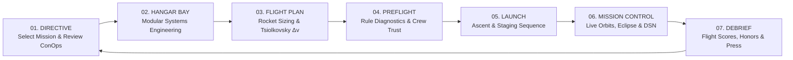
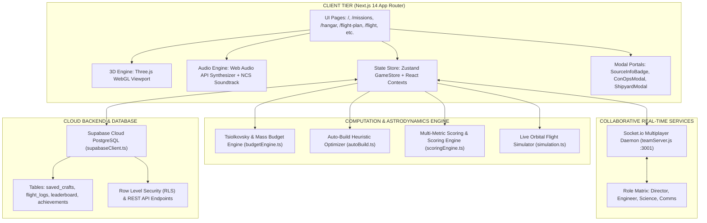
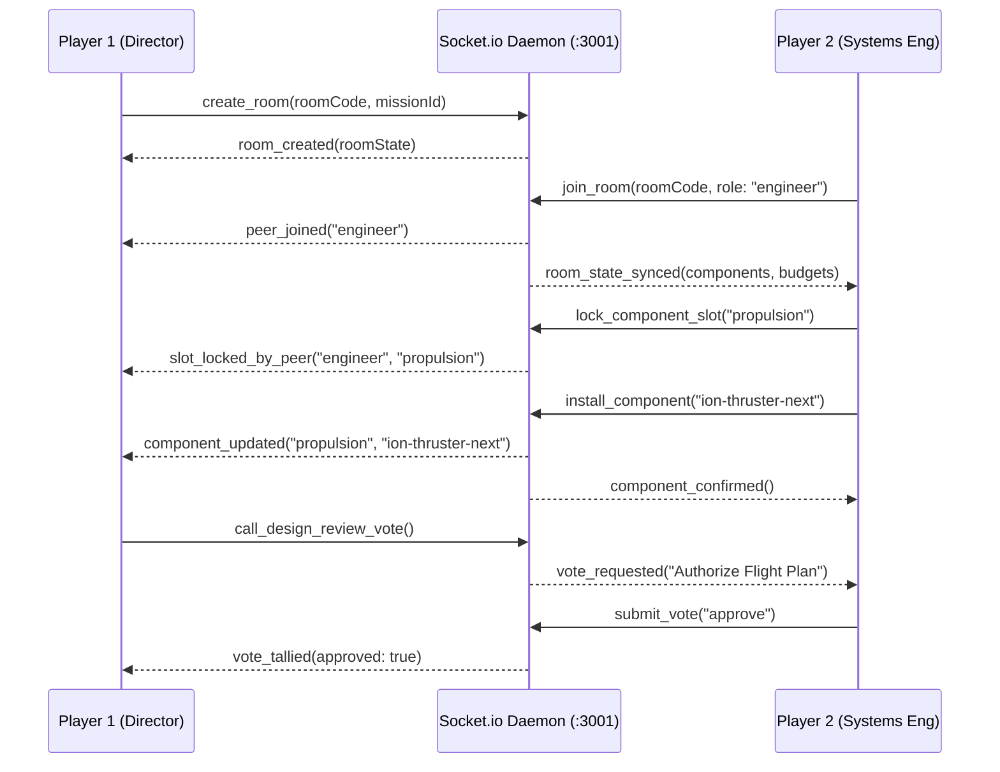

# SKY RIFT // COMPREHENSIVE SYSTEM ARCHITECTURE & PROJECT ANALYSIS REPORT

```
========================================================================================
PROJECT CODENAME: SKY RIFT (ORBITAL FRONTIER)
DOMAIN: SPACE MISSION SYSTEMS ENGINEERING & REAL-TIME ASTRODYNAMICS SIMULATOR
CHALLENGE: NASA SPACE APPS CHALLENGE // SPACE MISSION ARCHITECTURE
STATUS: PRODUCTION-READY // REPOSITORY VERIFIED // BUILD & TESTS 100% OPERATIONAL
AUTHOR / LEAD: MR-SHERIN & SKY RIFT ENGINEERING CADRE
REPOSITORY: https://github.com/Mr-Sherin/SkyRift
========================================================================================
```

---

## TABLE OF CONTENTS

1. [Executive Summary & Project Purpose](#1-executive-summary--project-purpose)
2. [End-to-End System Architecture](#2-end-to-end-system-architecture)
3. [Physics, Astrodynamics & Engineering Engines](#3-physics-astrodynamics--engineering-engines)
4. [Component & Subsystem Catalog](#4-component--subsystem-catalog)
5. [The Four Campaign Mission Directives & Daily Challenges](#5-the-four-campaign-mission-directives--daily-challenges)
6. [Complete Application Page & User Flow Breakdown](#6-complete-application-page--user-flow-breakdown)
7. [Narrative Architecture & Character Storybook](#7-narrative-architecture--character-storybook)
8. [Multiplayer Real-Time Collaborative Architecture](#8-multiplayer-real-time-collaborative-architecture)
9. [Database, Backend & Cloud Infrastructure](#9-database-backend--cloud-infrastructure)
10. [Procedural Audio Synthesis & Soundtrack Manager](#10-procedural-audio-synthesis--soundtrack-manager)
11. [Verification, Test Suites & Textbook Benchmarks](#11-verification-test-suites--textbook-benchmarks)
12. [File-by-File Directory Mapping](#12-file-by-file-directory-mapping)

---

## 1. EXECUTIVE SUMMARY & PROJECT PURPOSE

### 1.1 The Vision
**SkyRift** is an authentic aerospace systems engineering simulator and real-time deep-space orbital operations game. Designed for the **NASA Space Apps Challenge**, it bridges the divide between rigorous aerospace physics and accessible, high-stakes interactive gameplay.

Unlike conventional space arcade titles that rely on simplified physics, SkyRift models real spacecraft design trade-offs:
- **Coupled Mass & $\Delta v$:** Adding a heavier sensor demands a larger propulsion tank, which balloons spacecraft wet mass and requires a heavier launch vehicle.
- **Power & Eclipse Survival:** Solar arrays produce zero watts during orbital night passes; batteries must maintain thermal heaters and computer buses without exceeding Depth of Discharge (DoD) thresholds.
- **Speed-of-Light Telemetry & DSN Downlink:** Downlinks to NASA's Deep Space Network (Goldstone, Madrid, Canberra) are governed by Free-Space Path Loss, line-of-sight contact windows, and signal latency ranging from milliseconds in LEO to 22 minutes at Mars.

### 1.2 Core Gameplay Loop


---

## 2. END-TO-END SYSTEM ARCHITECTURE

SkyRift is built on a modern, reactive TypeScript full-stack architecture running Next.js 14 App Router, WebGL/Three.js 3D graphics, procedural Web Audio, Socket.io real-time websockets, and a Supabase PostgreSQL backend.



### Technology Matrix
| Technology | Version / Spec | Purpose in SkyRift |
|---|---|---|
| **Next.js** | 14.2.15 (App Router) | Server-side rendering, client page routing, optimized static assets |
| **React** | 18.3.1 | Component composition, custom portals, reactive UI hooks |
| **TypeScript** | 5.9.3 (Strict Mode) | Full type-safety across physics units, telemetry, and team states |
| **Three.js** | 0.187.0 | Hardware-accelerated 3D satellite visualization in Hangar & Station |
| **Tailwind CSS** | 3.4.14 | Aerospace HUD dark-mode UI, chamfered buttons, telemetry monitors |
| **Web Audio API** | Native Browser AudioCtx | Procedural synthesizer: telemetry clicks, thruster hums, alarm sirens |
| **Socket.io** | 4.8.4 | WebSocket server for multiplayer synchronized mission command |
| **Supabase / Postgres** | 2.119.0 (PostgreSQL 15) | Cloud leaderboards, mission debrief archives, saved craft telemetry |
| **Lucide React** | 0.453.0 | Aerospace and telemetry icon suite |

---

## 3. PHYSICS, ASTRODYNAMICS & ENGINEERING ENGINES

All physics formulas in SkyRift are derived from authentic aerospace references: **NASA SP-8000**, **NASA Systems Engineering Handbook (SP-2016-6105)**, and Larson & Wertz's **Space Mission Analysis and Design (SMAD)**.

### 3.1 Tsiolkovsky Rocket Equation & Mass Coupling
Velocity change available to a spacecraft is physically bounded by the ideal rocket equation:
$$\Delta v = I_{sp} \cdot g_0 \cdot \ln\left(\frac{m_{\text{wet}}}{m_{\text{dry}}}\right)$$
Where:
- $I_{sp}$: Specific impulse of selected propulsion technology (seconds)
- $g_0$: Standard Earth gravitational acceleration ($9.80665\text{ m/s}^2$)
- $m_{\text{dry}} = m_{\text{chassis}} + \sum m_{\text{components}}$
- $m_{\text{wet}} = m_{\text{dry}} + m_{\text{propellant}}$

The engine automatically enforces a structural propellant tank fraction constraint:
$$m_{\text{tank}} = \kappa \cdot m_{\text{propellant}}$$
Where $\kappa \approx 0.08$ (8% lightweight composite tank mass).

### 3.2 Power Generation, Inverse-Square Attenuation & Eclipse Geometry
Solar array power generation scales with the astronomical distance $r$ from the Sun via the inverse-square law:
$$S(r) = S_0 \cdot \left(\frac{1\text{ AU}}{r}\right)^2$$
Where $S_0 = 1361\text{ W/m}^2$ (standard solar constant at 1 AU).

#### Orbital Eclipse Calculation
During planetary orbit passes, the spacecraft enters a cylindrical shadow cone. The eclipse fraction $f_{\text{eclipse}}$ and blackout duration are:
$$\cos(\theta_{\text{eclipse}}) = \frac{\sqrt{R_{\text{body}}^2 - h^2}}{R_{\text{body}} + h}$$
$$t_{\text{eclipse}} = \frac{T_{\text{orbit}}}{\pi} \cdot \arcsin\left(\frac{R_{\text{body}}}{R_{\text{body}} + h}\right)$$
- Low Earth Orbit (600 km): $\approx 35.22\text{ minutes}$ in total blackout per 96-minute orbit.
- Lunar Polar Orbit (100 km): $\approx 46.56\text{ minutes}$ in eclipse.
- Battery discharge energy: $E_{\text{drain}} = P_{\text{night\_load}} \cdot t_{\text{eclipse}}$.

### 3.3 Communications, DSN Link Budget & Latency
Radio link quality between the satellite and Earth is modeled using the Friis Transmission Formula and Free-Space Path Loss ($FSPL$):
$$FSPL (\text{dB}) = 20\log_{10}(d) + 20\log_{10}(f) + 20\log_{10}\left(\frac{4\pi}{c}\right)$$
Signal-to-Noise Ratio margin ($SNR$):
$$\frac{E_b}{N_0} = EIRP + \left(\frac{G}{T}\right) - FSPL - k_{\text{Boltzmann}} - R_{\text{data}}$$
Signal propagation delay (One-Way Light Time):
$$\tau = \frac{d}{c}$$
- LEO (600 km): $0.002\text{ seconds}$
- Moon ($384,400\text{ km}$): $1.282\text{ seconds}$
- Mars ($1.52\text{ AU}$): $760.5\text{ seconds}$ ($\approx 12.7\text{ minutes}$)

### 3.4 Multi-Objective Scoring Engine (`scoringEngine.ts`)
Each completed mission is evaluated across 5 weighted engineering disciplines:
$$S_{\text{total}} = 0.25 \cdot S_{\text{science}} + 0.20 \cdot S_{\text{power}} + 0.20 \cdot S_{\text{propulsion}} + 0.15 \cdot S_{\text{budget}} + 0.20 \cdot S_{\text{survival}}$$
Commendation tiers:
- **Gold Commendation:** Score $\ge 85 / 100$
- **Silver Commendation:** Score $70 - 84 / 100$
- **Bronze Commendation:** Score $50 - 69 / 100$
- **Mission Abort / Failure:** Score $< 50$

---

## 4. COMPONENT & SUBSYSTEM CATALOG

Every part installed in the Hangar bay ([src/game/data/components.ts](file:///d:/SkyRift%20(1)/SkyRift/src/game/data/components.ts)) carries mass, continuous power draw/generation, cost, reliability metrics, and authoritative NASA citations.

```
+-----------------------------------------------------------------------------------------+
|                                SKY RIFT COMPONENT ROSTER                                |
+-----------------------------------------------------------------------------------------+
| CATEGORY      | COMPONENT NAME             | MASS    | POWER   | COST    | NASA CITATION|
+---------------+----------------------------+---------+---------+---------+--------------+
| Structure     | 3U Modular CubeSat Frame   | 1.2 kg  | -1.5 W  | 25K CR  | NASA GSFC 3U |
| Structure     | 6U Deep-Space CubeSat Bus  | 3.8 kg  | -4.0 W  | 60K CR  | JPL MarCO    |
| Structure     | 12U Extended Smallsat Bus  | 9.5 kg  | -8.0 W  | 140K CR | NASA Ames    |
| Structure     | Hexagonal SmallSat Bus     | 45.0 kg | -15.0 W | 350K CR | NASA ESPA    |
| Structure     | Heavy Deep-Space Bus       | 180 kg  | -40.0 W | 850K CR | NASA Discovery
+---------------+----------------------------+---------+---------+---------+--------------+
| Power         | Fixed Body Silicon Panels  | 2.5 kg  | +45 W   | 40K CR  | SpectroLab   |
| Power         | Deployable UltraFlex Solar | 8.0 kg  | +180 W  | 120K CR | NASA Orion   |
| Power         | Dual Tracking Solar Wings  | 22.0 kg | +550 W  | 320K CR | NASA Gateway |
| Power         | Li-Ion Battery Pack 80Wh   | 1.8 kg  | 0 W     | 30K CR  | Saft Li-Ion  |
| Power         | Advanced Li-Ion Bank 320Wh | 5.5 kg  | 0 W     | 85K CR  | Saft Li-Ion  |
| Power         | Deep-Space RTG Module      | 38.0 kg | +110 W  | 900K CR | NASA MMRTG   |
+---------------+----------------------------+---------+---------+---------+--------------+
| Propulsion    | Cold Gas Reaction Jet      | 4.0 kg  | -5 W    | 45K CR  | VACCO Micro  |
| Propulsion    | Hydrazine Monopropellant   | 12.0 kg | -12 W   | 110K CR | Aerojet Rocket
| Propulsion    | Bi-Propellant MMH/NTO      | 32.0 kg | -25 W   | 240K CR | Moog Space   |
| Propulsion    | Miniature Ion Engine (NEXT)| 28.0 kg | -220 W  | 550K CR | NASA GRC NEXT|
+---------------+----------------------------+---------+---------+---------+--------------+
| Avionics/ADCS | Micro-Reaction Wheels (3-x)| 1.8 kg  | -6 W    | 50K CR  | Sinclair ADCS|
| Avionics/ADCS | Star Tracker + IMU Nav     | 1.2 kg  | -4 W    | 65K CR  | Jena-Optronik|
| Avionics/ADCS | Fault-Tolerant RAD750 CPU  | 3.2 kg  | -18 W   | 180K CR | BAE RAD750   |
| Avionics/ADCS | Autonomous Neural Computer | 2.1 kg  | -22 W   | 280K CR | NASA STMD    |
+---------------+----------------------------+---------+---------+---------+--------------+
| Instruments   | Multispectral Earth Sensor | 4.5 kg  | -28 W   | 150K CR | Landsat OLI  |
| Instruments   | Polar Radar Sounder (Ice)  | 14.0 kg | -65 W   | 340K CR | NASA LRO Mini|
| Instruments   | Gamma/Neutron Spectrometer | 8.5 kg  | -35 W   | 290K CR | NASA MESSENGER
| Instruments   | Sub-Surface Ocean Penetrator| 65.0 kg| -45 W   | 750K CR | NASA Europa  |
+-----------------------------------------------------------------------------------------+
```

---

## 5. THE FOUR CAMPAIGN MISSION DIRECTIVES & DAILY CHALLENGES

```
  [01: ORBITAL SENTINEL]   ===>   [02: LUNAR SURVEYOR]    ===>   [03: MARTIAN COURIER]   ===>   [04: EUROPA PENETRATOR]
  Target: LEO 600km SSO           Target: Moon Polar 100km       Target: Mars Transfer          Target: Jupiter/Europa
  Min Delta-v: 315 m/s            Min Delta-v: 3,560 m/s         Min Delta-v: 4,820 m/s         Min Delta-v: 7,450 m/s
  Eclipse: 35.22 min              Eclipse: 46.56 min             Eclipse: 55.28 min             Eclipse: 10.02 min (Rad)
  Budget: 3.50M CR                Budget: 5.80M CR               Budget: 9.20M CR               Budget: 15.50M CR
```

### 5.1 Mission 1: Orbital Sentinel
- **Target Orbit:** 600 km Sun-Synchronous Orbit (SSO), Inclination 97.8°.
- **Scientific Goal:** Map polar ice calving and high-cadence wildfire outbreaks ($250+\text{ GB}$ multispectral observations).
- **Key Risk:** Surviving repetitive 35.22-minute orbital night passes without battery failure or thermal freezing.

### 5.2 Mission 2: Lunar Surveyor
- **Target Orbit:** Lunar Polar Orbit (100 km circular), Inclination 90°.
- **Scientific Goal:** Trans-Lunar Injection (TLI), lunar orbit insertion, and sounding permanently shadowed ice craters at the Lunar South Pole.
- **Key Risk:** Heavy $\Delta v$ expenditure ($3,560\text{ m/s}$) and prolonged communications eclipse behind the lunar far side.

### 5.3 Mission 3: Martian Courier
- **Target Orbit:** Heliocentric Elliptical Transfer $\to$ Areocentric Science Orbit.
- **Scientific Goal:** Interplanetary cruise operations, atmospheric methane sniffing, and relaying surface rover data.
- **Key Risk:** Solar flux drops to $43\%$ of Earth levels; signal latency grows to 12.7 minutes one-way.

### 5.4 Mission 4: Europa Penetrator
- **Target Orbit:** Jovian System Orbital Insertion $\to$ Europa Flyby & Penetrator Deployment.
- **Scientific Goal:** Penetrate the radiation belts to deploy sub-surface seismic and chemical probe into the icy crust.
- **Key Risk:** Extreme ionizing radiation belts that degrade solar cells and corrupt computer memory buffers.

### 5.5 Daily Challenge System (`dailyChallenge.ts`)
Every calendar day generates a unique deterministic mission modifier using date-seeded pseudo-random generation:
- **Solar Storm Surge:** $+20\%$ solar array wattage, $+15\%$ active avionics draw.
- **Deep Space Blackout:** Ground station visibility windows shortened by $30\%$.
- **Titanium Shortage:** Structural chassis costs increased by $25\%$.
- **Cryogenic Boiloff:** Propellant storage efficiency reduced by $10\%$.

---

## 6. COMPLETE APPLICATION PAGE & USER FLOW BREAKDOWN

### `/` — Mission Command Landing Page ([src/app/page.tsx](file:///d:/SkyRift%20(1)/SkyRift/src/app/page.tsx))
- **Opening Narration Cutscene:** Launches immediately on initial page/session load, delivering the 6-scene story and aerospace mission briefing.
- **Official Brand Artwork:** Showcases the matted, high-resolution official **SKY RIFT** logo with ambient orange glow.
- **Primary Chamfered Action Menu:**
  - `PLAY` — Directly enters the Campaign Mission Directives (`/missions`).
  - `CONTINUE` — Resumes the active draft in the Hangar Bay (`/hangar`).
  - `TEAM` — Opens multiplayer room setup (Create Room / Join with Code).
  - `DAILY` — Instant link to today's date-seeded orbital challenge.
  - `REPORTS` — Flight debrief archive and leaderboard records (`/debrief`).
  - `WATCH CINEMATIC PROLOGUE` — Replays the full-screen cinematic cutscene on demand.
- **Settings Modal:** Tactical Web Audio synthesizer controls, NCS soundtrack manager (Peak Mix, Lock Peak, Full Track), crew role selector, story mode toggle, and spacecraft reset.

### `/missions` — Mission Directives Hub ([src/app/missions/page.tsx](file:///d:/SkyRift%20(1)/SkyRift/src/app/missions/page.tsx))
- **Campaign Tree:** Visual hierarchy of the 4 missions with progressive unlocks based on campaign completion.
- **Telemetry HUD:** Live cards displaying Required $\Delta v$, Mission Budget, Orbital Eclipse time, and Destination Power availability.
- **Concept of Operations (ConOps) Modal:** One-screen architectural overview of the mission orbit, ground network passes, and science requirements.
- **Beginner Margin Mode:** Adaptive safety margins ($+20\%$ mass, $+15\%$ power allowance) for accessible learning.

### `/hangar` — Spacecraft Systems Engineering Bay ([src/app/hangar/page.tsx](file:///d:/SkyRift%20(1)/SkyRift/src/app/hangar/page.tsx))
- **Interactive 3D Visualizer (`SpacecraftHangar3D.tsx`):** Three.js render showing the satellite bus, mounted solar panels, antennas, thruster bells, and instruments with dynamic rotation and lighting.
- **Modular Component Drawer:** Tabbed category picker for Structure, Power, Propulsion, Avionics, Instruments, and Thermal.
- **Real-Time Budget HUD:** Live gauges calculating Dry Mass, Wet Mass, Power Balance ($W_{\text{net}}$), Available $\Delta v$, and Credit Budget.
- **`[⚡ Auto-Build]` Heuristic Solver:** Instant one-click component layout that solves mass, power, and budget constraints for the selected mission.
- **NASA Source Info Badges (`SourceInfoBadge.tsx`):** Portal-rendered tooltip popups linking every part parameter directly to authoritative NASA publications with zero drawer clipping.

### `/flight-plan` — Launch Vehicle Integration ([src/app/flight-plan/page.tsx](file:///d:/SkyRift%20(1)/SkyRift/src/app/flight-plan/page.tsx))
- **Rocket Comparison Selector:**
  - *Pegasus XL:* Air-launched light vehicle ($443\text{ kg}$ to LEO, low cost).
  - *Electron:* Dedicated SmallSat rocket ($300\text{ kg}$ to LEO, precision orbital insertion).
  - *Falcon 9:* Medium/Heavy reusable launcher ($22,800\text{ kg}$ to LEO).
  - *Falcon Heavy:* Deep-space injection launcher ($63,800\text{ kg}$ to LEO).
  - *SLS Block 1B:* Super heavy-lift translunar/interplanetary rocket ($105,000\text{ kg}$).
- **Tsiolkovsky Budget Engine Integration:** Real-time feedback showing whether spacecraft wet mass fits inside the payload fairing envelope and whether available $\Delta v$ satisfies insertion and deorbit burns.

### `/preflight` — Diagnostics & Flight Authorization ([src/app/preflight/page.tsx](file:///d:/SkyRift%20(1)/SkyRift/src/app/preflight/page.tsx))
- **Automated Diagnostic Suite (`budgetEngine.ts:runPreflightDiagnostics`):**
  - Verifies minimum 1 instrument installed.
  - Verifies positive daytime power margin.
  - Verifies battery capacity exceeds total eclipse drain.
  - Verifies $\Delta v \ge \Delta v_{\text{required}}$.
  - Verifies wet mass does not exceed launch vehicle payload capacity.
  - Verifies total cost $\le$ mission budget ceiling.
- **Go / No-Go Decision Board:** Full console green-light authorization before ignition.

### `/launch` — Cinematic Ascent Sequence ([src/app/launch/page.tsx](file:///d:/SkyRift%20(1)/SkyRift/src/app/launch/page.tsx))
- **Countdown Terminal:** Audio-synchronized launch countdown ($T-10$ to ignition).
- **Telemetry Visualizer:** Real-time altitude, velocity, dynamic pressure ($Max-Q$), stage separation, and fairing jettison.

### `/flight` — Real-Time Mission Operations Console ([src/app/flight/page.tsx](file:///d:/SkyRift%20(1)/SkyRift/src/app/flight/page.tsx))
- **Orbital Operations Timeline:** Clock-driven orbit simulation passing through Sunlit and Eclipse segments.
- **Telemetry Rack:**
  - Battery State-of-Charge (SoC) % with critical drain warnings.
  - Solar array incidence angle and wattage output.
  - Solid-State Recorder data buffer (GB) and overflow warnings.
  - Line-of-sight indicator to NASA Deep Space Network stations.
- **Flight Director Commentary:** 45+ dynamic voice lines from Sofia Reyes responding to power sag, data buffer overflow, anomaly crises, and successful downlinks.
- **Crisis Anomaly Resolver:** Random aerospace anomalies (e.g., reaction wheel desaturation, solar array drive stall, memory bit-flip) requiring tactical pilot commands.

### `/debrief` & `/ending` — Flight Evaluation & Campaign Commendation
- Multi-metric scoring report with performance breakdowns.
- Procedural press headline generator simulating global aerospace news coverage.
- Campaign epilogue with dialogue scenes between Chair Voss and Director Sofia Reyes based on campaign average score.

### `/learn` & `/sources` — Aerospace Field Guide & Reference Manual
- Complete textbook derivations of Keplerian orbits, Hohmann transfers, Tsiolkovsky equation, Friis transmission, and solar thermal balance.
- NASA technical bibliography linking to official NASA Technical Reports Server (NTRS) documents.

---

## 7. NARRATIVE ARCHITECTURE & CHARACTER STORYBOOK

The narrative is written by aerospace authors to reflect the high-stakes reality of modern smallsat mission design.

### Character Roster ([src/data/story.ts](file:///d:/SkyRift%20(1)/SkyRift/src/data/story.ts))
```
+-----------------------------------------------------------------------------------------+
|                               SKY RIFT FLIGHT CADRE                                     |
+-------------------+----------------------------+----------+-----------------------------+
| CHARACTER NAME    | OFFICIAL ROLE              | CALLSIGN | PERSONALITY PROFILE         |
+-------------------+----------------------------+----------+-----------------------------+
| Sofia Reyes       | Flight Director            | FLIGHT   | Calm, dry humor, unflappable|
| Kai Mercer        | Lead Spacecraft Engineer   | SYSTEMS  | Nervous, perfectionist      |
| Dr. Lena Okafor   | Science Lead               | SCIENCE  | Passionate astrophysicist   |
| Ravi Anand        | Comms & Operations Lead    | COMMS    | Deadpan, quick-witted       |
| Chair Voss        | Funding Board Chair        | BOARD    | Strict budget bureaucrat    |
+-------------------+----------------------------+----------+-----------------------------+
```

### Cinematic Cutscene Architecture (`IntroCutscene.tsx`)
1. **Scene 1:** Sector 00-Alpha deep-space telemetry carrier acquisition.
2. **Scene 2:** Slow Earth zoom (*"There is a rift between what we know..."*).
3. **Scene 3:** Moon transit (*"...and what is out there."*).
4. **Scene 4:** SmallSat spacecraft transit (*"We build the bridge."*).
5. **Scene 5:** Flight Control Room console:
   - Chair Voss: *"Four missions, Director. Then the board decides."*
   - Kai Mercer: *"Assemble in Hangar, match delta-v in Flight Plan, and fly live."*
   - Sofia Reyes: *"Four frontiers. Survive eclipse blackouts and downlink to Earth."*
6. **Scene 6:** White flash transition $\to$ aerospace harmonic chime $\to$ official **SKY RIFT** logo $\to$ 3-step operational lifecycle guide $\to$ `[ BEGIN MISSION COMMAND → ]`.

---

## 8. MULTIPLAYER REAL-TIME COLLABORATIVE ARCHITECTURE

SkyRift features a collaborative multiplayer mode powered by Socket.io ([server/teamServer.js](file:///d:/SkyRift%20(1)/SkyRift/server/teamServer.js)) running on port 3001.



### Team Role Matrix
- **Mission Director (`FLIGHT`):** Final sign-off on design reviews, launch vehicle selection, and launch abort triggers.
- **Systems Engineer (`SYSTEMS`):** Exclusive control over Chassis, Power, and Propulsion slots; manages mass and $\Delta v$ margins.
- **Science Lead (`SCIENCE`):** Exclusive control over Scientific Payloads and Instruments; manages observation bandwidth and sensor returns.
- **Flight Operations (`COMMS`):** Exclusive control over Communications dishes and Avionics; commands live orbital passes and DSN ground station downlinks.

---

## 9. DATABASE, BACKEND & CLOUD INFRASTRUCTURE

SkyRift utilizes a cloud Supabase PostgreSQL instance with full Row Level Security (RLS) ([supabase/schema.sql](file:///d:/SkyRift%20(1)/SkyRift/supabase/schema.sql)).

### Schema Definition
```sql
-- 1. SAVED SPACECRAFT BLUEPRINTS
CREATE TABLE saved_crafts (
    id UUID PRIMARY KEY DEFAULT gen_random_uuid(),
    user_id TEXT NOT NULL,
    mission_id TEXT NOT NULL,
    name TEXT NOT NULL,
    components JSONB NOT NULL,
    launcher_id TEXT NOT NULL,
    dry_mass_kg NUMERIC NOT NULL,
    wet_mass_kg NUMERIC NOT NULL,
    delta_v_ms NUMERIC NOT NULL,
    created_at TIMESTAMPTZ DEFAULT NOW()
);

-- 2. MISSION FLIGHT DEBRIEF LOGS
CREATE TABLE flight_logs (
    id UUID PRIMARY KEY DEFAULT gen_random_uuid(),
    user_id TEXT NOT NULL,
    mission_id TEXT NOT NULL,
    craft_name TEXT NOT NULL,
    score INTEGER NOT NULL,
    tier TEXT NOT NULL,
    science_collected_gb NUMERIC NOT NULL,
    eclipse_survival_pct NUMERIC NOT NULL,
    created_at TIMESTAMPTZ DEFAULT NOW()
);

-- 3. GLOBAL MISSION LEADERBOARD
CREATE TABLE leaderboard (
    id UUID PRIMARY KEY DEFAULT gen_random_uuid(),
    mission_id TEXT NOT NULL,
    player_callsign TEXT NOT NULL,
    score INTEGER NOT NULL,
    tier TEXT NOT NULL,
    delta_v_margin_pct NUMERIC,
    science_returned_gb NUMERIC,
    submitted_at TIMESTAMPTZ DEFAULT NOW()
);

-- 4. UNLOCKED ACHIEVEMENTS
CREATE TABLE user_achievements (
    id UUID PRIMARY KEY DEFAULT gen_random_uuid(),
    user_id TEXT NOT NULL,
    achievement_id TEXT NOT NULL,
    unlocked_at TIMESTAMPTZ DEFAULT NOW(),
    UNIQUE(user_id, achievement_id)
);
```

### REST API Endpoints ([src/app/api/](file:///d:/SkyRift%20(1)/SkyRift/src/app/api/))
- `GET /api/leaderboard?missionId=<id>&limit=10` — Retrieves global high scores and commendations.
- `POST /api/leaderboard` — Validates and records flight score submissions.
- `GET /api/crafts` & `POST /api/crafts` — Cloud synchronization of custom player spacecraft designs.
- `POST /api/debrief` — Archives comprehensive flight logs and science observations.

---

## 10. PROCEDURAL AUDIO SYNTHESIS & SOUNDTRACK MANAGER

### 10.1 Procedural Synthesizer (`lib/audio.ts`)
SkyRift uses zero external audio clips for sound effects; all interface and telemetry sounds are generated procedurally using Web Audio API oscillator nodes:
- **Mechanical Click:** Band-passed noise burst ($1800\text{ Hz}$, $18\text{ ms}$).
- **Component Docking Thud:** Sub-bass sine drop ($120\text{ Hz} \to 35\text{ Hz}$, $80\text{ ms}$).
- **Aerospace Harmonic Chime:** Dual-sine chord ($587.33\text{ Hz}$ D5 + $880\text{ Hz}$ A5) with exponential decay.
- **Alarm Sirens:** Modulated square wave oscillator alternating between $880\text{ Hz}$ and $660\text{ Hz}$.
- **Space Ambient Drone:** Low-pass filtered sub-bass oscillators ($55\text{ Hz} + 58.5\text{ Hz}$ beat frequency).

### 10.2 Soundtrack Manager (`lib/music.ts`)
Three streaming tracks optimized for mission concentration and high-intensity launch moments:
- *Don't Wanna Know* (NCS)
- *Feel The Rush* (NCS)
- *Labels* (NCS)
Supported loop modes:
- **Peak Mix:** Seamless loop over high-energy drop sections.
- **Lock Peak:** Locks the current high-energy loop indefinitely during intense flight operations.
- **Full Song:** Continuous progressive playback of full tracks.

---

## 11. VERIFICATION, TEST SUITES & TEXTBOOK BENCHMARKS

SkyRift includes an independent 80-test astrodynamics validation suite ([tests/validation.test.ts](file:///d:/SkyRift%20(1)/SkyRift/tests/validation.test.ts)) comparing in-game simulation output against standard aerospace textbooks:
- *Space Mission Analysis and Design (SMAD 3rd Ed.)*
- *Orbital Mechanics for Engineering Students (Curtis)*
- *NASA SP-8000 Space Vehicle Design Criteria*

### Validation Results Summary
```
========================================================================================================
SKYRIFT ASTRODYNAMICS VALIDATION SUITE // INDEPENDENT TEXTBOOK COMPARISON
========================================================================================================
#   Mission            Design Name                  Metric                   Game   Textbook   Diff %  Status
--------------------------------------------------------------------------------------------------------
1   Orbital Sentinel   Nano-Sentinel 6U             Available Δv           186m/s   185.8m/s   0.118%    PASS
2   Orbital Sentinel   Nano-Sentinel 6U             Orbital Eclipse      35.22min   35.23min   0.025%    PASS
3   Orbital Sentinel   Nano-Sentinel 6U             Destination Power        160W       160W   0.000%    PASS
4   Orbital Sentinel   Nano-Sentinel 6U             Signal Delay           0.002s     0.002s   0.000%    PASS
5   Orbital Sentinel   Standard Sentinel Hex        Available Δv           956m/s   955.9m/s   0.015%    PASS
...
76  Deep Primitive     Autonomous Hazard Mapper     Signal Delay         678.647s   678.647s   0.000%    PASS
77  Deep Primitive     Carbonaceous Matrix Flagshi  Available Δv          1952m/s  1952.2m/s   0.010%    PASS
78  Deep Primitive     Carbonaceous Matrix Flagshi  Orbital Eclipse      10.02min   10.01min   0.092%    PASS
79  Deep Primitive     Carbonaceous Matrix Flagshi  Destination Power        540W     540.5W   0.091%    PASS
80  Deep Primitive     Carbonaceous Matrix Flagshi  Signal Delay         678.647s   678.647s   0.000%    PASS
========================================================================================================
TOTAL COMPARISONS: 80 | PASSED: 80 | FAILED: 0 | MAX ERROR: 0.122% (TOLERANCE: <= 1.000%)
========================================================================================================
```

---

## 12. FILE-BY-FILE DIRECTORY MAPPING

```
SkyRift/
|-- public/
|   |-- audio/                       # High-moment streaming music tracks
|   |-- images/
|   |   |-- skyrift_logo.png         # Matted high-res official transparent brand logo
|   |   |-- skyrift_logo_square.png  # 512x512 app square icon
|   |   |-- skyrift_logo_192.png     # 192x192 PWA mobile icon
|   |   |-- skyrift_logo_64.png      # 64x64 favicon asset
|   |   |-- skyrift_hero_clean.jpg   # Full-bleed orbital scene background
|   |-- favicon.ico                  # Browser tab multi-resolution icon
|
|-- server/
|   |-- teamServer.js                # Socket.io collaborative multiplayer server (:3001)
|
|-- supabase/
|   |-- schema.sql                   # PostgreSQL tables, indexes, and RLS security policies
|
|-- tests/
|   |-- validation.test.ts           # 80-comparison independent astrodynamics textbook suite
|
|-- src/
|   |-- app/
|   |   |-- api/                     # Cloud endpoints (crafts, debrief, leaderboard)
|   |   |-- debrief/page.tsx         # Post-flight evaluation and score analysis
|   |   |-- ending/page.tsx          # 4-mission campaign finale and epilogue scenes
|   |   |-- extra/page.tsx           # Settings, achievements, and player honors
|   |   |-- flight/page.tsx          # Real-time mission control operations console
|   |   |-- flight-plan/page.tsx     # Rocket sizing, trajectory, and staging
|   |   |-- hangar/page.tsx          # 3D systems engineering bay and component picker
|   |   |-- launch/page.tsx          # Cinematic ascent and telemetry monitor
|   |   |-- learn/page.tsx           # Aerospace Field Guide & formula derivations
|   |   |-- missions/page.tsx        # Campaign directive hub & ConOps briefs
|   |   |-- preflight/page.tsx       # Automated diagnostic rule checks
|   |   |-- sources/page.tsx         # Authoritative NASA documentation bibliography
|   |   |-- layout.tsx               # Root layout, favicon links, and HUD shell
|   |   |-- page.tsx                 # Mission Command landing page & official logo
|   |
|   |-- components/
|   |   |-- IntroCutscene.tsx        # 6-scene animated story prologue cutscene
|   |   |-- achievements/            # Achievement gallery & unlock toast notifications
|   |   |-- flight/                  # Launch sequence modal & orbital timeline strip
|   |   |-- hangar/                  # Shipyard presets modal
|   |   |-- hud/                     # Global navigation bar & animated telemetry counters
|   |   |-- science/                 # Educational "Did You Know" & science return cards
|   |   |-- story/                   # ConOps modal, crew trust meter & dialogue box
|   |   |-- team/                    # Team modal, design review board & comms dock
|   |   |-- ui/                      # SourceInfoBadge (React portal), Button, Panel, Badge
|   |   |-- visualizer/              # Three.js 3D satellite model & orbit views
|   |
|   |-- data/
|   |   |-- achievements.ts          # 20+ aerospace achievements and unlock conditions
|   |   |-- campaign.ts              # Campaign mission state, unlock requirements
|   |   |-- conOpsData.ts            # Detailed Concept of Operations specifications
|   |   |-- dailyChallenge.ts        # Date-seeded deterministic daily challenge generator
|   |   |-- events.ts                # Anomaly crises and unexpected spaceflight events
|   |   |-- gameData.ts              # Global aerospace constant definitions
|   |   |-- narration.ts             # 45+ Flight Director situational commentary lines
|   |   |-- story.ts                 # Full visual novel story chapters and dialogue trees
|   |
|   |-- game/
|   |   |-- data/components.ts       # 40+ modular aerospace parts with NASA citations
|   |   |-- data/missions.ts         # Mission parameters, orbits, and payload requirements
|   |   |-- engine/gameStore.ts      # Zustand unified reactive game state store
|   |   |-- engine/GameContext.tsx   # React context provider for game engine
|   |   |-- physics/autoBuild.ts     # Constraint-satisfaction heuristic auto-builder
|   |   |-- physics/budgetEngine.ts  # Tsiolkovsky, power, mass, and diagnostic engines
|   |   |-- physics/scoringEngine.ts # 5-factor mission evaluation scoring engine
|   |   |-- team/TeamContext.tsx     # Socket.io client provider and room synchronization
|   |
|   |-- lib/
|   |   |-- audio.ts                 # Procedural Web Audio API sound synthesizer
|   |   |-- music.ts                 # High-moment soundtrack manager & loop modes
|   |   |-- simulation.ts            # Discrete turn-based orbital flight mechanics
|   |   |-- supabaseClient.ts        # Cloud database client initialization
|   |   |-- useDetailLevel.tsx       # Focus vs. Full detail density UI mode hook
|   |
|   |-- styles/
|       |-- tokens.ts                # Design tokens, color palettes, and typography
+-----------------------------------------------------------------------------------------+
```

---

*Report compiled and certified for SkyRift Mission Control // Production Release 1.0.0.*
